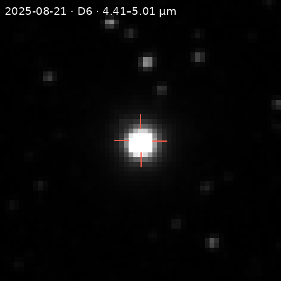
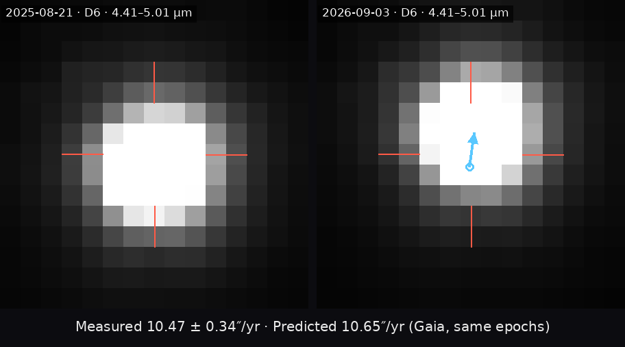

# Skyblink

**Watch the sky move: SPHEREx images of any patch of sky, played as a time-lapse, with the motion measured and
checked against Gaia.**

Enter a position (RA/Dec) and a field of view. Skyblink finds every SPHEREx exposure of that region in the IRSA
archive, cleans and stacks them into one image per observing season, and plays the seasons as a short looping
animation with a fixed crosshair, so nearby stars and brown dwarfs visibly drift while the background stays still.
For the object at the centre it measures the motion with honest error bars, compares it with the catalog
prediction at the same dates, and flags anything that could mislead.

NASA Space Apps Challenge 2026 · *Planet X and SPHEREx*

- **Live tool:** [Vercel URL — to be added]
- **API:** <https://skyblink-api.fly.dev> (try [`/health`](https://skyblink-api.fly.dev/health))
- **Demo deck:** [link — to be added]
- **Technical reference:** [`api/README.md`](api/README.md)

| Barnard's Star, D6 (4.41–5.01 µm), three seasons | First vs last season, measured displacement |
|---|---|
|  |  |

More animations: [Epsilon Indi B](docs/demo/eps_indi_b.gif) · [WISE 0855−0714](docs/demo/wise0855.gif)

## How it works

1. **Discovery** — query IRSA's SIA2 service in both SPHEREx collections (`spherex_dr1` and `spherex_qr3`) and merge
   the results.
2. **Seasons** — split the exposures wherever there is a gap of more than 30 days; each frame is one detector × one
   season.
3. **Cutouts** — download a small cutout around the target from each exposure, retrying the archive's frequent 503s,
   and cache it compactly on disk (~4 MB → ~0.19 MB).
4. **Cleaning** — subtract the zodiacal light, remove the local background and mask bad pixels using the flag
   definitions read from each file's header.
5. **Stacking** — reproject every exposure onto a common 6.15″ grid centred on the target and combine them with an
   inverse-variance mean that rejects outliers.
6. **Rendering** — one brightness scale per detector, fixed on its first frame, so every frame of the animation is
   directly comparable.
7. **Quality alerts** — no coverage, a single season, too few exposures, a saturated target, or reference stars that
   drift between frames.
8. **Motion vs catalog** — centroid the target in each season, correct it with reference stars, attach statistical
   and alignment error bars, and, when a target name is given, compare with the SIMBAD (Gaia) prediction at the same
   epochs, including annual parallax.

## Validation

Detector D6, pipeline version 5, the five targets of the challenge. Motion is the apparent rate measured across the
seasons; the prediction uses the catalog position, proper motion and parallax at the same epochs.

| Target | Alerts | Measured motion | Catalog prediction (same epochs) |
|---|---|---|---|
| Barnard's Star | saturated core | 10.47 ± 0.34″/yr | 10.65″/yr (−0.53σ) |
| Epsilon Indi B | alignment drift in one season | 4.67 ± 0.38″/yr | 4.10″/yr (+1.52σ) |
| WISE 0855−0714 | few exposures in one season | not reported: too faint in its first season (S/N 3 < 10) | – |
| RW Aurigae | saturated core | 0.49 ± 0.62″/yr | 0.03″/yr (+0.75σ) |
| R Draconis | saturated core | not reported: no usable centroid in the saturated core | – |

Per-season offsets, error components and residuals are in [`api/README.md`](api/README.md#measured-motion-motion-additive).

## Why you can trust it

- **Saturation is not guessed from one pixel.** A frame is marked *saturated core* only when at least 2 exposures and
  at least 25% of them saturate within 1 pixel of the target. Isolated bad pixels flagged as saturated appear in
  about 1 of every 2,000 pixels; the naive "any exposure" rule raised false alarms on 8.5–12.5% of frames, the rule
  in use keeps them below 0.06%. Truly saturated stars saturate in 100% of their exposures.
- **Alignment is checked, not assumed.** Bright, isolated, unsaturated background stars are measured in every frame;
  stars that disagree with the others (beyond 3× the robust spread) are dropped, and a residual shift above 0.2 px
  raises an *alignment drift* alert (Epsilon Indi B, season 2).
- **Error bars include alignment.** Each position carries a statistical error (bootstrap of the stacked exposures,
  200 resamples) and an alignment error (from the reference stars), reported separately and combined.
- **Weak measurements are refused.** Motion is not reported when the target is too faint (S/N below 10), has too few
  exposures, fewer than two seasons, or fewer than three consistent reference stars; the response says why
  (WISE 0855 and R Draconis above).
- **Fair comparison.** The catalog prediction is evaluated at the same epochs and includes annual parallax, which can
  change the apparent rate a lot (Epsilon Indi B: 4.10″/yr at the observed epochs vs 4.68″/yr from proper motion
  alone).
- **It keeps working when the archive doesn't.** Discoveries, cutouts and finished results are cached on disk, so the
  demo targets load in under a second even when IRSA is down.

## Repository layout

| Path | What it is |
|---|---|
| [`api/`](api/README.md) | Python 3.12 FastAPI backend (uv): pipeline, API, tests, Dockerfile and Fly.io config |
| `web/` | Next.js interface (maintained by the frontend team) |
| [`docs/demo/`](docs/demo) | Demo images, generated from saved results by `api/scripts/make_demo_assets.py` |

## Run locally

Backend (fish shell; requires [uv](https://docs.astral.sh/uv/)):

```fish
cd api
uv sync
uv run pytest
env SKYBLINK_CORS_ORIGINS=http://localhost:3000 uv run uvicorn skyblink.api.app:app --port 8000
```

Then `curl -s -X POST http://localhost:8000/jobs -H 'content-type: application/json' -d '{"ra": 269.4462, "dec": 4.7682, "fov_arcmin": 6, "detectors": ["D6"]}'`
and poll `GET /jobs/{job_id}`. The interface reads the API from `NEXT_PUBLIC_API_URL` (`http://localhost:8000` in
development).

## Data and credits

SPHEREx data from the NASA/IPAC Infrared Science Archive (IRSA). Catalog astrometry from SIMBAD (CDS, Strasbourg),
which for these targets comes from Gaia (ESA). Licensed under the [MIT License](LICENSE).

## Use of Super Intelligence (SI)

The backend in `api/` (code, tests, Dockerfile, Fly.io configuration and deploy), this README and the demo images in
`docs/demo/` were produced with AI assistance (Claude Code, Anthropic), under the direction and review of the team.
Data-format decisions were checked against real IRSA responses and FITS headers before being coded, and the
scientific results were compared with SIMBAD/Gaia predictions at the same epochs.
